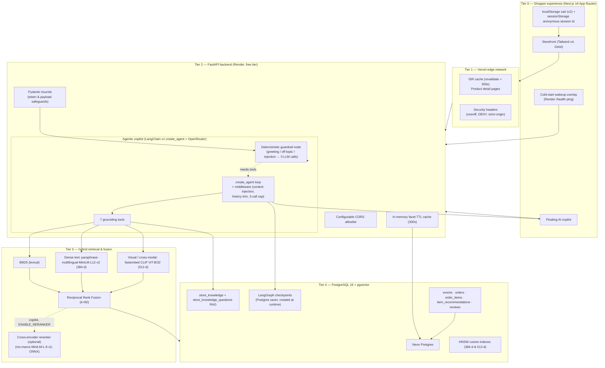
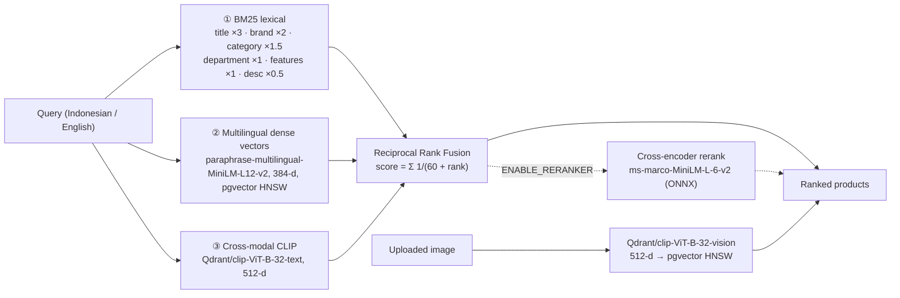
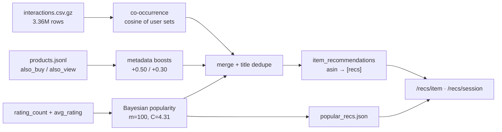

# Toko Marcell — Bilingual Hybrid Retrieval & Agentic AI E-Commerce Engine

[](https://toko-marcell.vercel.app)
[](https://python.org)
[](https://github.com/pgvector/pgvector)
[](https://fastapi.tiangolo.com)
[](https://langchain.com)
[](https://openrouter.ai/)
[](https://nextjs.org)
[](https://docker.com)
[](./.github/workflows/ci.yml)

> **Toko Marcell** is an end-to-end, production-deployed e-commerce platform built from scratch to
> engineer and benchmark **bilingual (Indonesian + English) hybrid lexical–dense–visual vector
> retrieval**, **RAGAS-evaluated store policy & sizing RAG**, and a **hardened agentic AI shopping
> copilot** over a real catalog of **4,670 curated products** (built from an initial 6,000 candidate extract).

| | |
|---|---|
| 🌐 **Live storefront** | [https://toko-marcell.vercel.app](https://toko-marcell.vercel.app) |
| ⚡ **Live API / interactive docs** | [https://toko-marcell-api.onrender.com/docs](https://toko-marcell-api.onrender.com/docs) |
| 📊 **IR & Multilingual benchmarks** | [`pipelines/results/search_eval_multilingual.json`](./pipelines/results/search_eval_multilingual.json) |
| 🧪 **RAGAS evaluation results** | [`pipelines/results/rag_eval.json`](./pipelines/results/rag_eval.json) |
| 🧭 **Copilot business-scenario benchmark** | [`pipelines/results/copilot_eval.json`](./pipelines/results/copilot_eval.json) |
| 🧾 **Benchmark source ledger** | [`pipelines/BENCHMARKS.md`](./pipelines/BENCHMARKS.md) — what each number is and how to reproduce it |

> **Note on the live API:** the backend runs on Render's free tier, so it sleeps after 15 minutes of
> inactivity and takes 30–50 s to wake. The storefront handles this explicitly with a health-check
> overlay (see [Cold-start UX](#-cold-start-ux-turning-a-free-tier-constraint-into-a-feature))
> instead of silently failing. The catalog itself is served from Vercel's edge cache and stays fast.

---

## Problem → Solution → Measured impact

**Who it is for:** an Indonesian online-fashion shopper who searches in mixed Indonesian/English and
needs fit and policy answers, and a small store owner who needs conversion without unmeasured AI
spend.

**North star:** **conversion and AOV of sessions that use an AI/search/rec surface** — reported as two
metrics, never blended into one score. **Guardrail:** **cost per assisted order**. Recommendation-rail
impressions are not instrumented yet, so today's definition covers search and copilot sessions. AOV,
revenue and copilot-vs-non-copilot cohorts are now computed from server-confirmed `orders` (phase 9).

| # | Problem | Feature | KPI it moves | Measured impact (committed artifact) |
|---|---|---|---|---|
| 1 | Mixed Indonesian/English or casual queries return nothing or the wrong products | Tri-modal bilingual retrieval: BM25 + multilingual MiniLM + CLIP → RRF, optional reranker, plus a deterministic ID→EN zero-result retry | **zero-result rate ↓**, **search-to-PDP ↑** | **Offline:** overall nDCG@10 **0.794 → 0.894**, Indonesian nDCG@10 **0.334 → 0.765**, HR@10 **100%** ([multilingual eval](./pipelines/results/search_eval_multilingual.json)); live search health is in `GET /search/insights` |
| 2 | Size uncertainty blocks the add-to-cart and creates returns | Deterministic category-aware `recommend_size` + authored brand cut rules + policy/size-guide RAG | **copilot assisted-add rate ↑**, **unanswered rate ↓** | **Offline retrieval:** RAGAS Context Recall **1.0000**, Context Precision **0.8750** ([RAG eval](./pipelines/results/rag_eval.json)); assisted-add and copilot quality are live (phase 9); sizing has no fit-accuracy benchmark yet |
| 3 | Repetitive shipping/returns/payment questions consume the owner's time | `lookup_store_policy`: hypothetical-question + chunk + IDF lexical RRF | **deflection ↑**, **unanswered rate ↓** | Same RAGAS artifact for retrieval; unanswered logging is live (phase 10) and conversation-level deflection is live in `GET /admin/kpi` (phase 12). There is no human handoff, so deflection means resolved in-copilot vs an honest “can't answer” |
| 4 | One-item baskets | Session-aware item-to-item CF + `build_outfit` with `total ≤ budget` enforced in code | **AOV ↑**, **copilot assisted-add rate ↑** | **Offline:** HR@10 **7.96% vs 0.18%** for popularity — **+4,322% relative** ([recommendation eval](./pipelines/results/recs_eval.json)); AOV from server-confirmed orders is live (phase 9) |
| 5 | Ungrounded AI answers and token-cost exposure | Guardrail short-circuit, rate limits, 7-tool whitelist, server-validated cart actions | **cost per conversation ↓**, **cost per assisted order ↓** | Guardrail/tool behaviour is unit-tested in CI; per-turn token cost, cost per conversation and cost per assisted order are live estimates (phase 13), governed by the budgets in [`docs/SLOS.md`](./docs/SLOS.md). No invoice or ROI claim |

Offline nDCG/RAGAS/HR numbers are proxies on small evaluation sets; they justify shipping a feature,
not a revenue claim. The live funnel endpoint reports its own caveats; AOV and cohorts are now
order-derived (phase 9), but the orders are still simulation rows.

**Full business case** — personas, five falsifiable hypotheses, KPI tree, non-goals and honest
limitations: **[docs/BUSINESS_CASE.md](./docs/BUSINESS_CASE.md)**. Every metric with its definition,
formula, source table and caveats: **[docs/METRICS.md](./docs/METRICS.md)**.

**What is not claimed:** revenue, profit, ROI, provider-invoice cost or measured SLO attainment.
Checkout is a simulation, there is no inventory or margin data, cohort comparison is correlational (no
live A/B), cost is a configured estimate, and brand size rules are authored demo data. See [Honest limitations](#-honest-limitations--what-is-not-built).

---

## TL;DR

**Toko Marcell is a working e-commerce engine, not a UI mock** — a Next.js storefront, a FastAPI
backend and PostgreSQL + pgvector, over a real 4,670-product catalog, deployed live.

**The five things worth inspecting** (each backed by a committed artifact):

| # | What | Result | Where |
|---|---|---|---|
| 1 | **Bilingual hybrid retrieval** — BM25 + multilingual MiniLM (`paraphrase-multilingual-MiniLM-L12-v2`, 384-d) + pre-trained CLIP (`fastembed`, 512-d) → RRF (`k=60`) + optional ONNX cross-encoder reranker | lifts overall hybrid **nDCG@10 0.794 → 0.894** (`100%` HR@10) and Indonesian **nDCG@10 0.334 → 0.765** | [API internals](./api/README.md#search--how-it-ranks) |
| 2 | **RAGAS-evaluated store policy & sizing RAG** — hypothetical-question vectors + direct-chunk vectors + IDF-weighted bilingual lexical RRF | **1.0000 Context Recall** & **0.8750 Context Precision** on 12 bilingual ID+EN queries (`ragas.evaluate`) | [`pipelines/eval_rag.py`](./pipelines/eval_rag.py) |
| 3 | **Hardened agentic copilot** — LangChain v1 `create_agent` + OpenRouter, LLM guardrail with 3-turn history window (3 user + 3 assistant), `<store_context>` indirect prompt-injection defense, 7 tools, LangGraph Postgres memory | answers only from tool evidence; blocks off-topic and multi-turn injection attempts | [copilot](./README.md#-the-agentic-copilot-admin-toko-marcell) |
| 4 | **Recommendations from real behaviour** — 3.36 M interactions | co-occurrence + Bayesian popularity, session-aware, cold-start safe (**+4,322% HR@10** vs popularity) | [recommendation engine](./README.md#-recommendation-engine) |
| 5 | **Raw `psycopg` v3 backend engineering** — connection pooling (`psycopg_pool`), zero ORM, 100% parameterized SQL (`psycopg.sql.Identifier`), bounded sliding-window rate limiting, and non-blocking async I/O | zero SQL injection vectors, bounded memory under IP churn, non-blocking ONNX inference | [backend security](./README.md#-production-reliability-caching--defensive-security) |

**Measured results** (committed artifacts in [`pipelines/results/`](./pipelines/results/)):

| Benchmark | Metric | BM25 | Hybrid (MiniLM) | Hybrid (Multilingual) | Trimodal |
|---|---|:---:|:---:|:---:|:---:|
| IR (32 queries) | nDCG@10 | 0.794 | 0.879 | **0.894** | 0.908 |
| IR (32 queries) | MRR@10 | 0.792 | 0.906 | **0.919** | 0.932 |
| IR — Indonesian (8q) | nDCG@10 | 0.334 | 0.622 | **0.765** | 0.821 |

| Recs (5 K users) | HR@10 | nDCG@10 |
|---|:---:|:---:|
| Random | 0.22% | 0.0011 |
| Popularity | 0.18% | 0.0008 |
| **Item-to-Item CF** | **7.96%** | **0.0501** |

| RAGAS Policy & Sizing RAG (12 ID+EN queries, k=3) | ID Precision@3 | ID Recall@3 | Context Precision | Context Recall |
|---|:---:|:---:|:---:|:---:|
| `direct_chunk` | 0.2222 | 0.6667 | 0.5417 | 0.6667 |
| `hypothetical_question` | 0.3056 | 0.9167 | 0.7222 | 0.9167 |
| **`hybrid_rrf` (`lookup_store_policy`)** | **0.3333** | **1.0000** | **0.8750** | **1.0000** |

Combining bilingual hypothetical-question embeddings (`store_knowledge_questions`), direct chunk
embeddings (`store_knowledge`), and IDF-weighted lexical keyword matching via Reciprocal Rank Fusion
achieves **1.0000 Context Recall** and **0.8750 Context Precision** in RAGAS evaluation
(artifacts: [`pipelines/results/rag_eval.json`](./pipelines/results/rag_eval.json),
[`pipelines/eval_rag.py`](./pipelines/eval_rag.py)).

**Copilot business scenarios (54 authored cases, CI-gated)** — the benchmark checks the four jobs,
not just retrieval. Guardrails: **18/18 (100%)** with per-label precision/recall; sizing:
**18/18 exact** contracts including brand offsets and honest unsupported/luggage/kids paths; outfit
budgets: **0 invariant violations** across 500k, 1M, 1.5M and 2.5M IDR; policy RAG: **10/10** expected
chunk titles in the top-3. The CI job fails below 95% guardrail accuracy, 100% sizing accuracy, any
outfit budget violation, or 90% policy recall. Artifact:
[`pipelines/results/copilot_eval.json`](./pipelines/results/copilot_eval.json).

**Stack:** Next.js 16 · React 19 · FastAPI · PostgreSQL 16 + pgvector (`psycopg` v3 + `psycopg_pool`) ·
`fastembed` (Multilingual MiniLM + CLIP ViT-B/32) · LangChain/LangGraph + OpenRouter (Gemini fallback) ·
RAGAS · Docker · Vercel + Render + Neon.

**Try it locally**

Prerequisite: **Docker with Compose**. Nothing else — Python, Node and PostgreSQL are not needed on
the host, and the database seeds itself on first boot.

```bash
# 1. get the code
git clone https://github.com/marknshoot/toko-marcell.git
cd toko-marcell

# 2. (optional) enable the AI copilot with a free OpenRouter key
#    https://openrouter.ai/keys  — skip this and everything else still works
cp .env.example .env        # then set OPENROUTER_API_KEY=... in .env

# 3. start the full stack
./run-local.sh              # → http://localhost:3000
```

`run-local.sh` also **prompts for the key** if `.env` is empty — press Enter to skip. Pressing Enter
leaves the copilot disabled; the rest of the site is unaffected.

| Works with no configuration | Needs an LLM key (OpenRouter, or Gemini as fallback) |
|---|---|
| catalog, hybrid text search, recommendations, reviews, demo checkout | the copilot's answers (`/copilot/chat` returns a friendly `503` without one) |

Or use the hosted build: [storefront](https://toko-marcell.vercel.app) / [API docs](https://toko-marcell-api.onrender.com/docs).

**Scope, honestly:** the storefront, QRIS checkout, couriers and order flow are a **demo simulation** —
they charge nothing and ship nothing. What is real: the catalog, the vector search, the ML study, the
recommendations and the agent's grounding. Every headline number is tagged in
[`BENCHMARKS.md`](./pipelines/BENCHMARKS.md) as committed-artifact / locally-reproducible /
author-measured. Open gaps are in [Honest limitations](#-honest-limitations--what-is-not-built).

---

## Why this project exists

This is a portfolio project, and it is deliberately **not** a CRUD tutorial with a prettier homepage.
It exists to demonstrate four things a hiring manager can verify rather than take on trust:

1. **Bilingual information retrieval engineering** — three independent rankers (hand-written BM25,
   multilingual dense sentence vectors via `paraphrase-multilingual-MiniLM-L12-v2`, and cross-modal
   pre-trained CLIP via `fastembed`) fused with Reciprocal Rank Fusion, plus an optional cross-encoder
   reranker (`ms-marco-MiniLM-L-6-v2`).
2. **RAGAS-evaluated store policy & sizing RAG** — hybrid retrieval fusing hypothetical-question
   embeddings, direct chunk embeddings, and IDF-weighted bilingual lexical keywords, benchmarked with
   standard RAGAS context precision and recall metrics.
3. **Hardened agentic LLM engineering** — a LangChain v1 `create_agent` loop that can only speak
   from tool results, fronted by an LLM guardrail with a 3-turn history window (3 user + 3 assistant),
   indirect prompt-injection isolation (`<store_context>` tags + header sanitization), a 7-tool
   whitelist, and token/call-count safeguards.
4. **Backend systems that survive production constraints** — raw `psycopg` v3 connection pooling
   without ORM bloat, 100% parameterized SQL, bounded sliding-window rate limiting, non-blocking
   async I/O (`asyncio.to_thread`), and server-authoritative checkout.

Every number below is either measured and stored in the repository or read from the code at runtime.
Nothing is invented. Where something is simplified or unfinished, it is written down as such in
[Honest limitations](#-honest-limitations--what-is-not-built).

---

## Table of contents

- [Problem → Solution → Measured impact](#problem--solution--measured-impact)
- [TL;DR](#tldr)
- [System architecture](#-system-architecture)
- [Tri-modal bilingual hybrid retrieval](#-tri-modal-bilingual-hybrid-retrieval)
- [Recommendation engine](#-recommendation-engine)
- [Sizing & fit knowledge base](#-sizing--fit-knowledge-base)
- [The agentic copilot](#-the-agentic-copilot-admin-toko-marcell)
- [Cold-start UX](#-cold-start-ux-turning-a-free-tier-constraint-into-a-feature)
- [Production reliability, caching & defensive security](#-production-reliability-caching--defensive-security)
- [Operations KPI dashboard](#-operations-kpi-dashboard)
- [Unit economics & SLOs](#-unit-economics--slos)
- [The data behind it](#-the-data-behind-it)
- [Quickstart — one command](#-quickstart--one-command)
- [Repository map](#-repository-map)
- [Testing & CI](#-testing--ci)
- [Design decisions & tradeoffs](#-design-decisions--tradeoffs-worth-reading)
- [Honest limitations — what is *not* built](#-honest-limitations--what-is-not-built)
- [Roadmap](#-roadmap)
- [Author](#-author)
- [Data licence & attribution](#-data-licence--attribution)

---

## 🏗️ System architecture

Four tiers, each with a single job. The storefront never opens a database connection; the backend
never renders HTML; the ML pipelines never serve a request.



### Tier responsibilities

| Tier | Technology | Owns | Explicitly does **not** |
|---|---|---|---|
| 0 — Client | Next.js 16 (App Router), React 19, Tailwind v4 | Rendering, cart state, session id, cold-start UX | Touch the database, know prices |
| 1 — Edge | Vercel CDN + ISR | Caching product pages, security headers | Hold business logic |
| 2 — API | FastAPI, Pydantic, LangChain, OpenRouter | REST validation, search, recs, copilot, checkout | Render HTML |
| 3 — Retrieval | BM25, fastembed (MiniLM + CLIP), ONNX reranker | Ranking | Persist state |
| 4 — Storage | PostgreSQL 16 + pgvector (Neon) | Catalog, vectors, events, orders, reviews, knowledge | Serve HTTP |

The single hard rule that keeps this clean: **the frontend never opens a database connection — it
only ever talks HTTP** (`shop/src/lib/api.js` is the only place that knows the API URL).

---

## ⚡ Tri-modal bilingual hybrid retrieval

Pure vector search fails on exact tokens (SKU numbers, model numbers like `501`, brand names).
Pure lexical search fails on typos, synonyms, and conversational Indonesian/English intent. Toko Marcell
runs all the rankers that matter and fuses them.



### 1. BM25 — a real, hand-written baseline

`api/search.py` implements Robertson & Zaragoza BM25 (`k1=1.5`, `b=0.75`, +1 IDF smoothing) with
**zero search dependencies**, because a baseline is only useful if it is honest enough to beat.
Field weighting (title 3.0 → description 0.5) is a practical alternative to one index per field;
BM25's saturation handles fractional term frequencies fine. The tokenizer does lowercase → accent
folding → alphanumeric filtering → stopword removal → a small **plural fold** (`sneakers→sneaker`,
`jeans→jean`). It is *not* a Porter stemmer; that limitation is stated where it lives, in the code.

**Honest baseline behaviour (measured in `api/tests/test_search_unit.py`):**

```
'levis 501'            → exact model numbers, four distinct variants
'waterproof jacket'    → raincoats and watertight shells
'shoes'  == 'shoe'     → plural folding makes the two score identically
'zzzz'                 → 0 results (no matching postings, returns immediately)
```

**Duplicate-title suppression.** 842 of the 6,000 built products are variants sharing a title with a
different ASIN. Without dedupe, a query like `jeans` shows the same title twice in the top 10.
Dedupe runs *before* pagination so `total` counts results a shopper can actually reach.

### 2. Bilingual dense semantic retrieval

384-dimensional `sentence-transformers/paraphrase-multilingual-MiniLM-L12-v2` embeddings (via **fastembed**,
ONNX runtime) stored in `products.embedding_ml` with an **HNSW cosine index** (alongside English-only
`all-MiniLM-L6-v2` in `products.embedding`). Text representation =
`title + brand + category + features + description`. This ranker lets both Indonesian shopper queries
(*"jaket musim hujan anti air"*, *"sepatu lari empuk nyaman"*) and English intent queries match English
catalog products without requiring manual translation.

### 3. Cross-modal visual retrieval (`fastembed` CLIP)

An uploaded photo is encoded with `Qdrant/clip-ViT-B-32-vision` (via `fastembed` ONNX runtime, offloaded
to a worker thread via `asyncio.to_thread`) to a 512-d vector and matched against `products.image_embedding`
(HNSW cosine). The same 512-d CLIP space lets a *text* query (`Qdrant/clip-ViT-B-32-text`) search product
*images* (`mode=trimodal`). Encoders are loaded lazily and cached per process.

### 4. Reciprocal Rank Fusion (k = 60)

$$
\text{RRF}(d) = \sum_{m \in M} \frac{1}{60 + r_m(d)}
$$

RRF is used instead of score normalization because BM25 scores are unbounded positives while cosine
similarities are bounded in [-1, 1]; RRF needs only *ranks*, so the heterogeneous rankers can be
combined with no calibration and no per-query tuning. `k=60` is the constant from
Cormack, Clarke & Buettcher (2009).

### 5. Zero-result recovery + search insights

When `GET /search` produces no ranked rows, it makes **one** deterministic second attempt with
`rewrite_id_to_en()` from `api/search.py`. The rewriter is a hand-maintained Indonesian→English
shopping dictionary — multi-word phrases first (`celana jeans → jeans`, `sepatu lari → running
shoes`, `jaket kulit → leather jacket`, `kaos kaki → socks`, `tahan air → waterproof`) then single
terms (`sepatu → shoes`, `hitam → black`, `pria → men`, `wanita → women`). Unknown words are preserved;
English or unchanged queries return `None`. The fallback keeps the same mode, department, category and
allowed facets. The response is backwards-compatible and adds:

```json
{ "rewritten": true, "fallback_query": "running shoes men", "original_query": "sepatu lari pria" }
```

`true`/strings only when the retry actually found products; otherwise `false`/`null`. The copilot's
`search_catalog` tool runs the same single retry on an empty result. `GET /search/insights?since_days=30`
turns the logged `search` events into `total_searches`, `zero_result_searches`, `zero_result_rate`,
`top_zero_result_queries`, `top_queries` (with a `zero_result` flag) and the session-level
`search_to_pdp_rate`. It reports the data it has: no fabricated by-mode breakdown, because the event
row does not carry the search mode.

### 6. Stage-2 cross-encoder reranking (`ENABLE_RERANKER`)

Top candidates can be re-scored by `Xenova/ms-marco-MiniLM-L-6-v2` run through **ONNX Runtime**
(~15–25 ms for ~20 candidates). A cross-encoder sees the query and document *together*, so it
captures relevance a bi-encoder cannot — the standard two-stage retrieve-then-rerank pattern.

### Evaluation harnesses (IR & RAGAS)

1. **Catalog IR (`pipelines/eval_search.py`)**: Evaluates **32 queries** across four groups — exact
   brand/SKU, category + explicit features, semantic/intent, and Indonesian/casual cross-lingual —
   across 5 modes (`bm25`, `vector`, `hybrid`, `hybrid+rerank`, `trimodal`). Switching hybrid search to
   `paraphrase-multilingual-MiniLM-L12-v2` lifts overall nDCG@10 **0.794 → 0.894** (`100%` HitRate@10)
   and Indonesian nDCG@10 **0.334 → 0.765** ([`pipelines/results/search_eval_multilingual.json`](./pipelines/results/search_eval_multilingual.json)).
2. **Store Policy & Sizing RAG (`pipelines/eval_rag.py`)**: Uses **RAGAS** (`ragas.evaluate` with
   `IDBasedContextPrecision`, `IDBasedContextRecall`, `NonLLMContextPrecisionWithReference`, and
   `NonLLMContextRecall`) on **12 bilingual ID+EN shopper queries**
   ([`pipelines/results/rag_eval.json`](./pipelines/results/rag_eval.json)). Fusing hypothetical
   questions (`store_knowledge_questions`), direct chunks (`store_knowledge`), and IDF-weighted
   bilingual lexical keywords via RRF (`hybrid_rrf`) lifts Context Precision from **0.5417 → 0.8750**
   and Context Recall from **0.6667 → 1.0000** (`12/12` queries).
3. **Copilot business scenarios (`pipelines/eval_copilot.py`)**: Runs **54 authored cases** from
   [`pipelines/golden/copilot.json`](./pipelines/golden/copilot.json) against the real guardrail,
   sizing, outfit and policy functions. The JSON artifact records per-case expected/actual values and
   hard CI gates: guardrail accuracy ≥95%, sizing accuracy 100%, zero outfit-budget violations, and
   policy top-3 recall ≥90% ([`pipelines/results/copilot_eval.json`](./pipelines/results/copilot_eval.json)).

---

## 🎯 Recommendation engine

Search answers "find me this". Recommendations answer "what next" — the surface where most e-commerce
demos cheat with a hard-coded "you may also like". There is none of that here: every rail is built
from the real **3.36 M-interaction log** and the catalog's own co-buy graph, then served through a
fallback chain so a **cold visit still gets a useful rail**.

### Serving, and why every request has an answer

| Surface | Endpoint | Mechanism | Cold fallback |
|---|---|---|---|
| Home rail | `GET /recs/session` | the visit's last 5 `view_product` / `add_to_cart` events → union of their item recs, excluding seen items | global popularity (`cold_popularity`) |
| Product page | `GET /recs/item/{asin}` | offline item-to-item table (`item_recommendations`) | same category → department popularity |
| Browse / cold | `GET /recs/popular` | review-volume ordering, optional department filter | — |

Each response includes a `strategy` field (`session_cf`, `item_cf`, `category_popularity_fallback`,
`cold_popularity`), so the UI can say *how* a rail was produced rather than guessing.

### The offline model (`pipelines/build_recs.py`)

1. **Popularity, Bayesian-smoothed.** A raw average rating rewards a product with three 5-star
   reviews. The baseline shrinks it toward the catalog mean instead:
   $\text{score} = (n\bar{r} + mC)/(n + m)$ with prior weight **m = 100** and prior mean **C = 4.31**.
   Global top-50 and top-30 per department, deduplicated by title.
2. **Item-to-item co-occurrence.** Cosine similarity over per-item user sets,
   $\cos(i,j) = co(i,j)/\sqrt{n_i}\,\sqrt{n_j}$, where `co` counts users who interacted with both.
   Ultra-popular items are capped at 5,000 sampled users so the candidate product stays bounded.
3. **Metadata boosts.** Amazon's `also_buy` adds **+0.50** and `also_view` **+0.30** to a candidate's
   score, so explicit co-purchase signals beat coincidental co-views.
4. **Title dedupe + cold fill.** Variants of the same title are collapsed; each item keeps up to 12
   recommendations, and anything with fewer than 6 is backfilled from category-popular then
   department-popular items — so no rail is ever empty.



### Why session-based, not user-based

The store has **no accounts** — deliberately, since the funnel needs to attribute a *visit*, not a
person, and carrying no PII is a feature. So online personalization uses the anonymous
`sessionStorage` id and the current visit's events, while the offline co-occurrence table supplies
long-horizon behaviour. That is the cold-start problem answered at four levels
(session → item → category → global), not hidden behind a login wall.

### Evaluation

`pipelines/eval_recs.py` runs **sequential leave-one-out** on users with ≥5 interactions: the target is
the user's final interaction and the penultimate item is the session context (a realistic "current
product page"), with everything else masked. It reports HR@10 / HR@5 / MRR@10 / nDCG@10 against random
and popularity baselines.

---

## 📏 Sizing & fit knowledge base

Sizing is the single biggest driver of fashion returns, and most "size chart" AI features hallucinate
one. Toko Marcell answers sizing questions from an **authored, versioned knowledge base** — nothing is
mined per product, and nothing is invented at answer time.

### The artefacts

| File | Role |
|---|---|
| [`api/knowledge/size_charts.md`](./api/knowledge/size_charts.md) | the human-readable guide: men's/women's tops, bottoms, dress, footwear, waist/belt, headwear, one-size/dimensions/unsupported, and the demo brand cut rules |
| [`api/knowledge/size_chart.json`](./api/knowledge/size_chart.json) | the same values machine-readable, with per-row `source` + `confidence`, read directly by `api/sizing.py` |
| [`api/knowledge/catalog_categories.json`](./api/knowledge/catalog_categories.json) | every distinct `(department, category)` pair in the seed catalog, produced by [`pipelines/extract_categories.py`](./pipelines/extract_categories.py) |
| [`api/knowledge/size_kind_map.json`](./api/knowledge/size_kind_map.json) | the explicit pair → size-kind map; unknown pairs fall back to `unsupported`, never `tops` |

All are labelled **"panduan umum toko"** — a store rule-of-thumb, explicitly *not* an official brand
chart. `size_charts.md` is also split by section header, embedded with MiniLM and ingested into
`store_knowledge`, so the RAG index and the deterministic tool answer from **the same source**.

### Two consumers, one source of truth

1. **`recommend_size` — deterministic, category-aware.** `api/sizing.py` dispatches on the product's
   size kind. Tops/bottoms/dress use TB/BB (bottoms can take an actual waist too), footwear uses foot
   length, belts use waist, and headwear uses head circumference. Unsupported categories return
   `applicable=false` with an honest reason; missing measurements return `required_inputs` instead of
   a guess. The brand cut rule is applied only after the category baseline. Every answer is framed as
   *"coba ukuran X dulu, ini perkiraan"* with a disclaimer — never a guarantee.
2. **`lookup_store_policy` — RAG.** The same guide is retrievable in prose, so "kalau tinggi 175 berat
   70 ambil apa di Dickies 874?" can be answered conversationally without the tool path.

### No-LLM sizing API

The product page does not need the copilot to get an honest answer:

- `GET /sizing/{asin}` → `{asin, size_kind, applicable, required_inputs, reason}` so the UI knows
  whether to ask for height+weight, foot length, waist, head circumference, or show a
  dimensions/unsupported/one-size note.
- `POST /sizing/recommend` with `{asin, height_cm?, weight_kg?, foot_length_cm?, waist_cm?,
  head_circumference_cm?}` (`extra="forbid"`, body-plausible bounds) → the same core result as the
  tool. Unknown ASIN is `404`; writes are rate-limited.
- The storefront component `shop/src/components/SizeAdvisor.js` renders adaptive inputs and shows a
  source/confidence badge plus the disclaimer.

### Why authored, not mined

An earlier Phase 4a experiment mined 622,530 fit mentions out of the 3.36 M-review corpus into
`product_fit` / `brand_fit` tables and surfaced them as per-product `runs_small / true_to_size /
runs_large` badges. It was removed, for three reasons:

- **Coverage was uneven in a way shoppers could not see.** A badge rendered only when a product had
  ≥ 5 mentions; below that it fell back to a brand aggregate, below 3 it silently disappeared. Two
  nearly identical products could show totally different, or no, guidance.
- **It was unreproducible without the 2.8 GB raw dump.** `data/processed/` is gitignored, so any
  deployment that did not run the pipeline served zero badges — with no error to notice.
- **It duplicated the brand rules it was supposed to correct.** The genuinely useful output was six
  brand-level cut rules (Dickies runs small; Champion and Carhartt are true to size; Birkenstock runs
  large; Levi's and TOMS true to size). Those now live in the guide as authored, reviewable text.

The brand rules themselves are kept, and they still encode the surprise findings — **Champion is not
"runs large"** and **Carhartt is only slightly roomy** — but as documented knowledge with a reviewer,
not as a silent weekly recompute. `product_fit`, `brand_fit`, `/products/{id}/fit`, `api/fit.py` and
`pipelines/build_fit_signals.py` are gone; an older database that still has the tables can drop them
with `DROP TABLE IF EXISTS product_fit, brand_fit;`.

---

## 🤖 The agentic copilot (Admin Toko Marcell)

An in-store stylist and customer assistant built on **LangChain v1 `create_agent`** (langchain
1.4.3, langgraph 1.2.12), split across `api/copilot_agent.py`, `api/copilot_tools.py`,
`api/copilot_llm.py`, `api/copilot_memory.py` and `api/guardrail.py`. The provider is **OpenRouter**
(OpenAI-compatible) whenever `OPENROUTER_API_KEY` is set — its free tier is far more generous than
Gemini's — with an optional generic OpenAI-compatible endpoint and **Google Gemini** behind it. The
design principle is boring on purpose: **the model never invents a product, a price, or a policy.**

**Text-only on purpose — the chat does not accept images.** The copilot runs on a text LLM, so it
takes no `image_url`/`imageUrl` and binds no `search_by_image` tool. Free vision-capable models have
very small request quotas, so no multimodal LLM is used. **Photo search still exists in the
storefront** via `POST /search/image` (the CLIP vision encoder embeds the upload and matches
`image_embedding` deterministically) — it is just a separate storefront feature, not a chat turn.

### Execution model

```mermaid
sequenceDiagram
    participant S as Shopper
    participant API as /copilot/chat
    participant G as Guardrail (deterministic, 0 LLM)
    participant A as create_agent loop (≤ 3 model calls)
    participant T as 7 tools
    participant D as Postgres + pgvector (incl. checkpointer)
    S->>API: {thread_id, message, context?}
    API->>G: classify
    Note over G: greeting / off-topic / injection<br/>→ canned reply, ZERO LLM calls
    G-->>API: canned reply (guardrail hit)
    G->>A: otherwise, run the agent
    Note over A: middleware injects page/pinned product,<br/>shown-products registry, browsing context;<br/>trims history; caps model calls at 3
    A->>T: tool calls
    T->>D: catalog / details / size / outfit / policy / cart
    D-->>T: authoritative rows
    T-->>A: compacted evidence
    A->>D: persist turn (PostgresSaver, thread_id)
    A-->>S: reply + products[≤6] + ui_actions
```

1. **LLM-based pre-agent guardrail (`api/guardrail.py`).** Before the tool-calling agent runs,
   `classify(message, history)` evaluates the user message alongside up to **3 user + 3 assistant**
   history turns using a fast LLM classifier (with deterministic regex fast-path for pure greetings/injections
   and full offline fallback when `COPILOT_FAKE_LLM=1`). Greetings, off-topic requests (code, SQL, maths,
   politics, medical/legal, creative) and multi-turn prompt-injection attempts receive a canned
   "Admin Toko Marcell" reply. The response carries a `guardrail` field (`greeting` | `off_topic` |
   `injection` | `null`) and the tests assert it.
2. **`create_agent` loop.** The agent plans tool calls, runs them, and composes the grounded reply in
   a single LangGraph loop. **Middleware** wraps it: `ContextInjectionMiddleware` injects the current
   page / pinned product (re-read from the DB), a `[Produk dalam percakapan ini] [1]…` shown-products
   registry and recent browsing context inside `<store_context>` tags; `TrimHistoryMiddleware` keeps
   history under a 2,000-token budget (char/4 estimate); `ModelCallLimitMiddleware` caps the turn at
   **3 model calls**.
3. **Grounded reply.** Products, prices and policy all come from tool evidence, in the "Admin Toko
   Marcell" voice (Indonesian or English, mirroring the shopper).

### The tool layer

Seven tools are bound to the agent (`GET /copilot/tools` lists them):

| Tool | Reads from | Answers |
|---|---|---|
| `search_catalog` | BM25 + MiniLM (pgvector) fused with RRF, optional reranker, real category enum + budget filters; one ID→EN retry on empty | "do you have…", style, outfit, budget |
| `get_product_details` | `products` by registry ref (`nomor 2`, `produk ini`), ASIN/id, or title fragment | fabric, specs, exact IDR price |
| `recommend_size` | `size_kind_map.json` + `size_chart.json` + demo brand cut rules | category-aware sizing (TB/BB, foot length, waist, head); `applicable=false` when the category has no defensible basis |
| `build_outfit` | catalog search; total summed and verified ≤ budget **in code** | top + bottom + shoes within budget |
| `lookup_store_policy` | `store_knowledge` / `store_knowledge_questions` (hypothetical-question RAG) | sizing (TB/BB), shipping, returns, QRIS demo |
| `add_to_cart` | re-reads the price from the DB, returns a `ui_action` the browser executes through `CartProvider` (localStorage) | "add this to my cart" |
| `flag_unanswered` | no catalog read; sets `ToolContext.unanswered`, so the turn recorder logs the truncated question with `outcome=unanswered` | honest "I'm not sure" fallback instead of guessing |

The prompt is deliberately scoped to three jobs — **sizing**, **store policy / QRIS / returns**, and
**outfit under a budget**. Product discovery still works, but replies stay short and point shoppers
to the store search bar for full-catalog browsing. Tool *results* are compacted before they re-enter
the prompt — a token-budget safeguard that also keeps answers focused. There is deliberately **no
order-status tool**, because checkout is a demo simulation with no fulfillment to look up.

### Grounding rules baked into the prompt

- Every product mentioned must come from a tool result. No invented brands, ASINs, stock, or discounts.
- Prices are always formatted as Indonesian Rupiah and always taken from the database.
- Sizing answers first ask for the measurement the category needs — TB/BB for tops/bottoms/dress,
  foot length for shoes, waist for belts, head circumference for hats — and never default to a tops
  size. Shoes, luggage, lingerie and other unsupported categories get an honest "cannot answer"
  rather than an invented S/M/L.
- Sizing answers apply the **authored brand cut rules** in the store's sizing guide — e.g. Dickies
  874's rigid 8.5 oz twill (and that **Dickies runs small**), Levi's 505 vs 501 fit differences
  (Levi's **true to size**), that **Champion and Carhartt are true to size** (not "runs large"), and
  that **Birkenstock runs large** (size down). These are authored in
  [`api/knowledge/size_charts.md`](./api/knowledge/size_charts.md) and
  [`api/knowledge/size_chart.json`](./api/knowledge/size_chart.json), not hallucinated and not mined
  per product.
- Outfit recommendations must sum to a total inside the shopper's stated budget.
- When tool evidence cannot answer, the model must call `flag_unanswered` and say it is unsure rather
  than guess; the question is logged (truncated to 300 characters) for later review.
- Off-topic requests are politely refused and redirected to fashion.

### Memory and session context

Conversation memory is a **LangGraph `PostgresSaver`** keyed by a browser-generated UUID `thread_id`
stored in `localStorage` under `tm_copilot_thread`. A sidecar `copilot_thread_activity` table tracks
last-touch time; a **7-day TTL cleanup** runs on startup and daily. `GET /copilot/threads/{thread_id}`
returns a thread's messages and `DELETE /copilot/threads/{thread_id}` clears it (`204`). The
checkpoint tables are created by the saver at runtime, not shipped in the seed.

Before the agent runs, `ContextInjectionMiddleware` also injects the shopper's recent
`view_product` / `add_to_cart` events and any page/pinned product — so "do you have these in black?"
has a referent. The per-turn registry is rebuilt from scratch, so it is re-seeded from the previous
turns' `ToolMessage` results; a follow-up like "nomor 2" or "yang kedua" keeps resolving to the
same product even though the tool context is new.

### Provider chain and deterministic testing

The LLM is assembled with `.with_fallbacks`: **OpenRouter** (primary) → an optional generic
OpenAI-compatible endpoint (`LLM_FALLBACK_BASE_URL` / `LLM_FALLBACK_API_KEY` / `LLM_FALLBACK_MODEL`)
→ **Gemini**. Setting `COPILOT_FAKE_LLM=1` swaps in a deterministic fake tool-calling model, so CI
exercises the full agent and tool path **without ever calling a real LLM**.

### API contract (v2)

`POST /copilot/chat` (JSON) and `POST /copilot/chat/stream` (Server-Sent Events emitting `token` and `done` events) accept `{session_id?, thread_id, message (1..2000), context?: {page_asin?,
referenced_asins[≤3]}}` with `extra="forbid"`. The turn payload contains `{reply, thread_id, products[≤6] (each
with a `ref`), ui_actions (`add_to_cart`), tool_calls, guardrail, took_ms}`.
In the storefront (`CopilotChat.js`), shoppers can search and attach up to 3 products via the paperclip (`📎`) menu (`referenced_asins`), see a pulsing `"Sedang berpikir..."` indicator while waiting for the first token, and view streamed replies rendered as GitHub Flavored Markdown (`react-markdown` + `remark-gfm`). Errors are `422` (validation), `429` (rate limit),
`503` (no LLM key) and `502` (upstream failure). `GET /copilot/tools` returns the 7 tool names.

### Knowledge base (RAG)

`api/knowledge_seed.py` chunks the two hand-written markdown sources
([`size_charts.md`](./api/knowledge/size_charts.md),
[`store_policies.md`](./api/knowledge/store_policies.md)) by section header, embeds each chunk with
MiniLM, and upserts them into `store_knowledge` (**34 chunks** after the startup knowledge seed). It also generates **120
hypothetical questions** (3–5 ID+EN per chunk) into `store_knowledge_questions` and indexes those —
embedding questions a shopper would actually ask rather than the raw policy text improves retrieval
quality on the committed [RAGAS evaluation](./pipelines/results/rag_eval.json). Nothing here is
scraped; it is authored store policy, which is why the copilot can be trusted about shipping, returns
and sizing.

> `seed_knowledge()` is idempotent: it returns early when `sizing_example` rows already exist. After
> editing `size_charts.md`, run `python -m knowledge_seed` from `api/` (its `__main__` forces a
> reload) so the database does not keep serving the previous guide.

---

## ⏱️ Cold-start UX: turning a free-tier constraint into a feature

Render's free tier spins the API down after ~15 minutes idle. The naive result is a storefront that
appears broken for 30–50 seconds. `shop/src/components/ServerWakeup.js` turns that into a designed
state:

- A debounced (600 ms) `GET /health` fires on first mount. If the server answers immediately, the
  overlay never appears — fast paths stay fast.
- If it does not, a **fullscreen frosted-glass overlay** shows a spinner and an honest message
  (*"Membangunkan server… Render free tier cold start (~30–50 dtk)"*).
- On success it flips to a green badge (*"Server siap & aktif!"*) for 2.5 s and unmounts.
- On failure it offers **retry** and **dismiss**, so the user is never trapped.

`checkHealth()` falls back to `/categories` if `/health` is blocked by a client shield/extension,
because a false "down" is worse than a slightly heavier probe.

---

## 🛡️ Production reliability, caching & defensive security

Built to be fast and honest on free infrastructure (Vercel + Render + Neon).

### Caching (four layers, each with a reason)

| Layer | Where | Setting | Why |
|---|---|---|---|
| Edge ISR | `app/product/[id]/page.js` | `revalidate = 300` | Product pages are read-heavy and change rarely; stale-while-revalidate removes origin latency on repeat visits |
| HTTP | Catalog endpoints | `public, max-age=60, s-maxage=300, stale-while-revalidate=60` | Lets any CDN/proxy cache; short browser TTL keeps the demo fresh |
| In-memory TTL | `/categories` facets | 300 s dict cache | Replaces a `GROUP BY` aggregate scan on every page load (~60 ms → ~2 ms) |
| Policy RAG TTL | `lookup_store_policy` | 600 s, 256 entries | Repeated shipping/returns/QRIS questions skip embedding + pgvector; cleared after a knowledge re-seed |

`POST /search/reindex` rebuilds the BM25 index **and** invalidates the facet cache, because after a
reseed the old index is silently stale and "why are my new products not searchable" is otherwise a
confusing hour.

### Defensive boundaries

- **AI token safeguard.** `/copilot/chat` enforces strict Pydantic bounds: ≤ 2,000 chars for the
  single message per turn, `extra="forbid"` on the request body, and no image payload (the chat is
  text-only). Oversized or malformed requests get a `422`, not a metered bill.
- **Server-authoritative checkout.** The client sends only `{asin, qty}`; the server looks up every
  price and computes the total. `ConfirmIn` sets `extra="forbid"`, so a request that *tries* to send
  a price is **rejected with a 422** rather than silently ignored. A tampered "pay Rp 1" is structurally
  impossible.
- **Image-search bounds.** MIME must be `image/*`, payload must be 50 bytes–10 MB; the copilot client
  caps uploads at 5 MB.
- **Configurable CORS.** `CORS_ORIGINS` is an allowlist in code (default `localhost` +
  `https://toko-marcell.vercel.app`) with an explicit `^https://.*\.vercel\.app$` regex so preview
  deployments work. The shipped Render blueprint sets `CORS_ORIGINS=*` so that every preview URL
  works without redeploys — a deliberate tradeoff, acceptable here because the API is stateless,
  credential-free, and sets no cookies. It is documented rather than hidden.
- **Frontend hardening.** `next.config.mjs` sets `X-Content-Type-Options: nosniff`,
  `X-Frame-Options: DENY`, `Referrer-Policy: strict-origin-when-cross-origin`, and a restrictive
  `Permissions-Policy` (`camera=(), microphone=(), geolocation=()`).
- **Payload hygiene in the UI.** `lib/api.js` never surfaces raw backend errors for the copilot/image
  search; it returns a friendly message instead of leaking internals.

### Honest funnel metrics

`GET /events/summary` computes funnel conversion **and returns its own `caveats` array**, so the
numbers cannot be read as more precise than they are:

1. `search_to_pdp` is a **session-level proxy** (a session that both searched and viewed a product),
   not a click-through rate — the click is not its own event yet.
2. `results_count` for `search` is client-supplied, so zero-result rate is only as trustworthy as the
   event stream. `GET /search/insights` surfaces the raw top queries instead of pretending otherwise.
3. Rates are `null`, never `0.0`, when a denominator is missing — an empty events table must not
   produce a fake "0% conversion".

`GET /events/summary` also carries a `copilot` block (`messages`, `product_clicks`, `add_to_cart`,
`total_add_to_cart`, `assisted_add_to_cart_rate` = `copilot_add_to_cart` / all add-to-cart, `null`
when there is no denominator) fed by the `copilot_message` / `copilot_product_click` /
`copilot_add_to_cart` event types — with a caveat that a copilot add fires both the generic and the
copilot event.

---

## 📊 Operations KPI dashboard

`GET /admin/kpi` and the token-gated page at `/admin/kpi` turn the measurement tables into one
operations view. The page is intentionally separate from the storefront: it calls the API with
`X-Admin-Token`, keeps the token in `sessionStorage` (or accepts it once as `?token=` and removes it
from the URL), and shows a clean entry form again on `403`. An unset `ADMIN_TOKEN` disables the
endpoint with `503`; local Docker Compose defaults it to `dev-admin-token` for the demo only.

Four cards cover the operational questions:

| Card | What it shows | Honest boundary |
|---|---|---|
| **Executive Revenue & Funnel** | Paid-order count, total IDR, AOV, and view→cart / cart→checkout / checkout→order / overall session rates | Revenue is only `orders.status='paid'`; steps are independent sessions, not a strict first-touch funnel |
| **Cohort Analysis** | Copilot vs non-copilot sessions, add-to-cart rate, conversion rate and AOV | Observational and self-selected — no randomized holdout, so never call it lift |
| **Copilot Performance & Safety** | Turn outcomes, final-turn deflection, p50/p95 latency, thumbs up/down | "Answered" is tool-grounded, not audited for correctness; deflection is self-service resolution, not human-agent deflection |
| **Search Health & Demand Signals** | Search count, zero-result rate, search→PDP, top missed queries | `results_count` is client-supplied; top queries are exact strings, not typo-clustered |

Every response carries `metadata.synthetic=true`, `environment='demo'` and the caveat
*"All metrics are derived from seeded/simulated demo data; not real customer revenue."* The UI repeats
that as a prominent **SYNTHETIC / DEMO DATA** badge. The API also returns a `unit_economics` block
with estimated cost per turn/conversation/assisted order; the four cards above do not render it yet.
Cost is an estimate from configured token prices, not an invoice. API details and the full response
shape are in [`api/README.md`](./api/README.md#admin-kpi-dashboard-get-adminkpi).

---

## 💵 Unit economics & SLOs

Cost starts as a per-turn estimate, not an invoice. `api/copilot_metrics.estimate_cost_usd()` uses
two configurable per-million-token prices — `LLM_INPUT_COST_PER_MILLION=0.15` and
`LLM_OUTPUT_COST_PER_MILLION=0.60` by default — and writes `copilot_turns.cost_usd` whenever the
provider reports token usage. A turn with no reported usage stays `NULL`, not `$0`. The pre-agent
guardrail's own LLM tokens are not part of the agent usage, so the estimate is a lower bound when
the guardrail runs.

Both measurement endpoints return the same `unit_economics` block:

| Field | Denominator | Why it matters |
|---|---|---|
| `total_cost_usd` | priced turns in the window | the numerator for every ratio |
| `avg_cost_per_turn_usd` | all copilot turns | includes zero-token guardrail turns |
| `cost_per_conversation_usd` | distinct `thread_id` | cost of one copilot conversation |
| `cost_per_resolved_conversation_usd` | threads with ≥1 `answered`/`cart` turn | cost of a resolved self-service conversation |
| `cost_per_assisted_order_usd` | paid orders whose session has a copilot turn | the north-star cost guardrail |

**Budgets:** **< $0.005 per conversation** and **< $0.02 per assisted order**. They are targets, not
measured historical results. The full latency, availability, error-budget, fallback and alert policy
is in [`docs/SLOS.md`](./docs/SLOS.md). Copilot total-turn p50/p95 latency is live; text/image search,
sizing and TTFT timing still need instrumentation, so no SLO-attainment percentage is claimed.

Two cost controls are implemented alongside the model:

- **`GUARDRAIL_LLM_MODE=ambiguous`** runs the deterministic regex guardrail first and skips the LLM
  classifier on decisive greeting/off-topic/injection labels. The default `always` keeps contextual
  LLM classification for every non-injection message. This is a cost/latency trade-off, not a
  security upgrade.
- **Policy RAG cache:** `lookup_store_policy` caches normalized `(query, limit)` results for 10
  minutes with a 256-entry bound, so repeated shipping/returns/QRIS questions skip embedding and
  pgvector. `clear_policy_cache()` runs after a knowledge re-seed.

---

## 📦 The data behind it

| | |
|---|---|
| Source | **Amazon Reviews 2018**, category *Clothing, Shoes & Jewelry* (McAuley Lab, UCSD) |
| Paper | Ni, Li, McAuley — *Justifying recommendations using distantly-labeled reviews and fine-grained aspects* (EMNLP 2019) |
| Licence | Free for **research / non-commercial** use; product text/images remain Amazon's |
| Raw files | reviews 1.27 GB + metadata 1.57 GB (~2.8 GB, not committed) |

**Why this dataset.** It is the canonical recommender-systems benchmark — so HR@10 / nDCG@10 numbers
are comparable with published work instead of self-graded — and it carries exactly the fields the
product needs: real titles, brands, prices, category trees, feature bullets and descriptions (search
+ NLP), plus `user_id / asin / rating / timestamp` (recs), plus `also_buy` / `also_view` (co-view).

**Why not the 2023 refresh.** `McAuley-Lab/Amazon-Reviews-2023` was tried and rejected on evidence:
in `Amazon_Fashion`, ~90% of items have no price and `categories` is empty, which makes a usable shop
catalog impossible.

### Pipeline in one line

```
11,285,464 reviews read → top candidates by interaction → quality filters → 6,000 products
→ dead-image & duplicate-title cleanup → 4,670 products served
```

Full provenance, quirks and filters: [`pipelines/README.md`](./pipelines/README.md).

| Data | Built | **Served (live/seeded)** |
|---|---:|---:|
| Products | 6,000 | **4,670** |
| Reviews | 46,700 | **46,700** |
| Interactions | 3,363,680 | (offline signal) |
| Distinct users | 972,184 | — |
| Knowledge chunks | — | 34 live · 23 in seed |
| Hypothetical questions | — | 120 live · 82 in seed |

Why 4,670 and not 6,000: after the catalog is built, `pipelines/cleanup_catalog.py` deletes products
whose image CDN link is dead (`image_embedding IS NULL`) and collapses duplicate title variants to the
best-rated one. The shipped seed (`data/seed/init.sql.gz`) is a dump of that cleaned database, so the
storefront's "4,670 verified products" copy is literally true.

The interactions matrix is **0.057% dense** (3,363,680 filled of 5,833,104,000 cells; 972,184 users,
min 198 / median 333 / max 19,693 interactions per item). The long tail is real, which is why item
recommendations combine co-occurrence with an embedding-based backfill for cold items.

### Database schema (Alembic migrations in `api/migrations/`, seeded offline)

```sql
products (
  id INTEGER PRIMARY KEY,            -- stable int, ordered by popularity
  asin TEXT NOT NULL UNIQUE,         -- real product id; the ML/event join key
  title TEXT NOT NULL,
  brand TEXT,
  price_usd NUMERIC(10,2) NOT NULL,  -- untouched source price
  price_idr INTEGER NOT NULL,        -- shop price at a fixed, documented demo rate
  department TEXT, category TEXT, category_path JSONB,
  description TEXT, features JSONB, image_url TEXT,
  avg_rating NUMERIC(3,2), rating_count INTEGER,
  also_buy JSONB, also_view JSONB,
  embedding vector(384),             -- MiniLM, HNSW cosine
  embedding_ml vector(384),          -- multilingual MiniLM (opt-in), HNSW cosine
  image_embedding vector(512)        -- CLIP,   HNSW cosine
)
events (id, session_id, event_type, asin, query, results_count, qty, price_idr, created_at)
orders (id, token, total_idr, item_count, status, session_id, created_at)
order_items (id, order_id, asin, title, qty, unit_price_idr)
item_recommendations (asin PRIMARY KEY, recs JSONB)
reviews (id, asin, rating, summary, comment, author, verified, review_date, created_at)
store_knowledge (id, category, title, content, embedding vector(384))
store_knowledge_questions (id, knowledge_id, question, embedding vector(384))
copilot_thread_activity (thread_id PRIMARY KEY, last_active_at)
-- LangGraph checkpoint tables are created by the PostgresSaver at runtime (not in the seed)
```

Notes that matter:

- **`id` vs `asin`.** Ints for the shop and the cart; ASIN for events, recs and ML joins. Both exist
  because the two consumers want different keys.
- **Prices.** `price_usd` is the dataset value, kept for auditability; `price_idr` is what the shop
  displays at a **fixed demo rate of 16,000 IDR/USD**, recorded in `stats.json`. It is a presentation
  conversion, not a live FX rate.
- **No fake completeness.** 4,689 of 6,000 products have a description and 5,371 have a brand at build
  time. Empty fields stay empty rather than being filled with invented text.
- **Migrations.** The schema is versioned with **Alembic** (`api/migrations/versions/`, hand-written
  SQL — no ORM; queries stay raw psycopg). The API runs `alembic upgrade head` on startup, and every
  revision is idempotent, so databases created before Alembic (the seed dump, Neon) are adopted
  without a manual `alembic stamp`. Details: [`api/README.md`](./api/README.md#schema).

---

## 🚀 Quickstart — one command

The whole stack is containerized. **Docker Compose** boots the Next.js storefront, the FastAPI
backend, and PostgreSQL 16 with pgvector **auto-seeded with the real catalog, reviews, vector
embeddings and knowledge base on first boot** — no manual pipelines, no downloads.

### Prerequisites

- **Docker** + **Docker Compose** (Docker Desktop, or `docker` + the Compose plugin).
- Python, Node and PostgreSQL are **not** required on the host.
- Optional: a free [OpenRouter API key](https://openrouter.ai/keys) — or a [Gemini key](https://aistudio.google.com/) as a fallback — to enable the AI copilot.

### Configure (optional)

Everything runs with **no configuration**. To turn on the copilot, create `.env` from the example and
set the key — or let `run-local.sh` prompt you for it:

```bash
cp .env.example .env
# edit .env →  OPENROUTER_API_KEY=sk-or-...
```

| Variable | Needed for | Default |
|---|---|---|
| `OPENROUTER_API_KEY` | the AI copilot (preferred provider) | empty → copilot disabled |
| `LLM_MODEL` | OpenRouter model id | `openrouter/free` (auto-routes the free pool) |
| `LLM_BASE_URL` | OpenRouter endpoint | `https://openrouter.ai/api/v1` |
| `LLM_FALLBACK_MODELS` | optional OpenRouter fallbacks (429/503) | *(empty)* |
| `LLM_FALLBACK_BASE_URL` · `LLM_FALLBACK_API_KEY` · `LLM_FALLBACK_MODEL` | optional generic OpenAI-compatible fallback endpoint | *(empty)* |
| `GEMINI_API_KEY` | the copilot **fallback** provider | empty → Gemini not used |
| `GEMINI_MODEL` | fallback model override | `gemini-3.5-flash-lite` |
| `TEXT_EMBED_MODEL` · `TEXT_EMBED_COLUMN` | opt-in multilingual embeddings (`…-MiniLM-L12-v2` + `embedding_ml`) | MiniLM default |
| `COPILOT_FAKE_LLM` | deterministic fake tool-calling model (tests/CI only) | unset |
| `DATABASE_URL` · `NEXT_PUBLIC_API_URL` · `INTERNAL_API_URL` | wiring the three services | pre-set in `.env.example` and `docker-compose.yml` |

### Run

```bash
git clone https://github.com/marknshoot/toko-marcell.git
cd toko-marcell
./run-local.sh              # builds + starts everything, waits for health, prints the URLs
# or: docker compose up -d --build
```

| Service | URL |
|---|---|
| 🌐 Storefront | [http://localhost:3000](http://localhost:3000) |
| ⚡ API + interactive docs | [http://localhost:8001/docs](http://localhost:8001/docs) |
| ❤️ Health | [http://localhost:8001/health](http://localhost:8001/health) |

```bash
docker compose logs -f    # stream logs
docker compose down       # stop
```

### What works without an LLM key

Browsing, filtering, **hybrid text search**, recommendations, reviews and the demo checkout all run
against the seeded database. Without a key, `/copilot/chat` returns a clean `503` with a friendly
message instead of crashing, and the copilot panel simply can't produce answers.

> **Got a 500 or an out-of-memory from the API instead?** That's a known image-search issue, not a
> setup problem — see [Honest limitations](#-honest-limitations--what-is-not-built). Text search is
> unaffected.

> **How the auto-seed works.** The Postgres container mounts `data/seed/init.sql.gz` (~33 MB) into
> `/docker-entrypoint-initdb.d/`, so the official image restores the complete schema, 4,670 products,
> HNSW indexes, 46,700 reviews, 23 legacy knowledge chunks (plus 82 questions), recommendations and
> a small demo funnel (~357 events, ~106 orders) in seconds on first boot. On API startup,
> `knowledge_seed` detects the legacy rows (no `sizing_example` category) and reseeds the current
> 34 chunks / 120 questions from the authored markdown. The ephemeral LangGraph checkpoint tables are
> excluded from the dump and recreated at startup.

### Running the pieces separately

```bash
# Backend + DB only (from api/), with an offline seed job behind a profile
cd api
docker compose up -d --build
docker compose run --rm seed --reset     # optional: reload catalog from data/processed
curl -s localhost:8001/health            # {"status":"ok"}

# Frontend only
cd shop && npm install && npm run dev    # needs an API at NEXT_PUBLIC_API_URL
```

To **regenerate the catalog from raw data** (≈8 min, streaming, no pandas), see
[`pipelines/README.md`](./pipelines/README.md).

---

## 📁 Repository map

```text
manual/
├── api/                          # FastAPI backend (owns all data + logic)
│   ├── main.py                   #   thin app factory: lifespan, CORS, schema migration, routers
│   ├── migrate.py · alembic.ini  #   `alembic upgrade head` on startup
│   ├── migrations/               #   Alembic env + versioned SQL revisions (0001 baseline, 0002 embedding_ml)
│   ├── config.py                 #   pydantic-settings Settings, cached get_settings()
│   ├── db.py                     #   psycopg_pool ConnectionPool, get_conn() / Depends
│   ├── schemas.py                #   shared Pydantic request/response models
│   ├── routers/                  #   one module per domain
│   │   ├── health.py             #     GET /health
│   │   ├── catalog.py            #     categories, products, product detail + row_to_product
│   │   ├── search.py             #     text search, insights, image search, reindex
│   │   ├── recs.py               #     popular, item-to-item, session recommendations
│   │   ├── reviews.py            #     product reviews
│   │   ├── events.py             #     funnel events + summary
│   │   ├── admin.py              #     token-gated synthetic KPI dashboard
│   │   ├── checkout.py           #     confirm checkout, order lookup
│   │   └── copilot.py            #     AI copilot chat + tool listing
│   ├── search.py                 #   BM25 + embeddings + RRF + CLIP; ID→EN rewriter
│   ├── reranker.py               #   Stage-2 ONNX cross-encoder
│   ├── copilot_agent.py          #   LangChain v1 create_agent loop + middleware
│   ├── copilot_tools.py          #   the 7 grounding tools (schema bound to the agent)
│   ├── copilot_llm.py            #   provider chain (.with_fallbacks) + COPILOT_FAKE_LLM
│   ├── copilot_memory.py         #   LangGraph PostgresSaver + thread activity / TTL
│   ├── guardrail.py              #   LLM-based 3-turn guardrail + deterministic regex fallback
│   ├── sizing.py                 #   category-aware recommend_size (size_kind dispatch)
│   ├── rate_limiter.py           #   bounded sliding-window per-IP rate limiter
│   ├── knowledge_seed.py         #   markdown → embedded store_knowledge + hypothetical questions
│   ├── knowledge/                #   authored size_charts.md, size_chart.json, size_kind_map.json, policies
│   └── tests/                    #   pytest suite (unit + RAGAS + live API, fake-LLM copilot)
├── docs/                         # business framing, no code
│   ├── BUSINESS_CASE.md          #   personas, problems → features → KPIs, hypotheses, KPI tree
│   ├── METRICS.md                #   KPI definitions, formulas, sources, caveats, phase status
│   └── SLOS.md                   #   latency/availability SLOs, cost budgets, fallback policy
├── shop/                         # Next.js 16 storefront
│   └── src/{app,components,lib}  #   routes (incl. /admin/kpi), UI, API client, session & cart state
├── pipelines/                    # offline data & retrieval engineering
│   ├── build_catalog.py          #   raw Amazon data → 6,000-product catalog (3 streaming passes)
│   ├── seed.py                   #   catalog → Postgres (offline, upsert by asin)
│   ├── cleanup_catalog.py        #   drop dead images + duplicate titles → 4,670 live
│   ├── build_recs.py             #   co-occurrence + co-view + popularity backfill → recs
│   ├── embed_catalog.py          #   384-d multilingual/English text embeddings + HNSW
│   ├── embed_images.py           #   pre-trained fastembed CLIP 512-d image embeddings + HNSW
│   ├── extract_reviews.py        #   top reviews per ASIN → reviews table
│   ├── eval_search.py            #   32-query 5-mode BM25 / vector / hybrid / rerank / trimodal IR harness
│   ├── eval_rag.py               #   RAGAS evaluation harness (direct_chunk vs hypothetical_question vs hybrid_rrf)
│   ├── eval_copilot.py           #   54-scenario guardrail/sizing/outfit/policy CI benchmark
│   ├── golden/copilot.json       #   authored business-scenario contracts
│   ├── eval_recs.py              #   leave-one-out HR@K / MRR / nDCG harness
│   ├── eda_interactions.py       #   sparsity, long tail, rating distribution
│   └── migrate_to_neon.py        #   local → Neon serverless migration
├── data/
│   ├── seed/init.sql.gz          # COMMITTED: the seeded database dump (works without raw data)
│   ├── knowledge/*.md            # COMMITTED: RAG source documents
│   ├── raw/                      # gitignored: ~2.8 GB downloads
│   └── processed/                # gitignored: reproducible artifacts (embeddings, recs, …)
├── docker-compose.yml            # one-command full stack
├── render.yaml                   # Render blueprint (API)
├── run-local.sh                  # friendly wrapper around docker compose
└── .github/workflows/ci.yml      # lint + test + build on every push/PR
```

> **What is and is not committed.** Only the seed dump and the knowledge documents are committed
> under `data/`; raw and processed data are gitignored because they are large and reproducible.
> A fresh clone runs immediately via Docker and can reproduce all embeddings and evaluation benchmarks
> from source.

---

## 🧪 Testing & CI

```bash
# Frontend: 36 tests across 7 files (components, cart, copilot, cold-start, admin, sizing)
cd shop && npm test

# Backend + pipelines
cd api && python3 -m pytest tests/          # 292 passed, 4 env-gated skips (needs a live DB)
python3 -m pytest pipelines/tests/          #   6 tests (pipeline maths, no DB)
# Run after the API/docker stack has seeded the RAG knowledge base:
python pipelines/eval_copilot.py --out pipelines/results/copilot_eval.json  # 54 scenarios
```

Every push and PR runs [`.github/workflows/ci.yml`](./.github/workflows/ci.yml):

| Job | Steps |
|---|---|
| **Frontend** (Node 22) | `npm ci` → `npm run lint` → `npm run test` → `npm run build` |
| **Backend & pipelines** (Python 3.12) | Ruff → full API suite against a Postgres service restored from the seed, with `COPILOT_FAKE_LLM=1` → pipeline tests → 54-scenario copilot business benchmark |
| **Render Deploy Status** (`main` push) | Triggers and polls the Render deployment until `live` when `RENDER_API_KEY` and `RENDER_SERVICE_ID` secrets are configured |

CI runs **Ruff + the full API suite** against a Postgres service restored from the committed seed,
with `COPILOT_FAKE_LLM=1` so the whole agent and tool path is exercised **without ever calling a real
LLM** — plus the frontend lint/test/build. The API tests cover the things that are easy to get wrong:
price-tampering rejection, duplicate-ASIN aggregation, event-type validation, session-id bounds,
search modes/filters/reindex, recommendation cold-start fallbacks, review aggregates, sizing
advisories, and the copilot's use cases + guardrails.

---

## 🧭 Design decisions & tradeoffs worth reading

These are the choices that shaped the project. Each is stated with the alternative that was rejected.

1. **Copy-before-code, facts-before-features.** The catalog is real data, not hand-written fixtures.
   The shop no longer contains a hard-coded product array; if the database is empty, the shop is
   empty. This costs a seed step and buys verifiability.
2. **Offline data, online serving.** The API creates schema but **never writes catalog rows**;
   `pipelines/seed.py` does. This keeps `docker compose up` a server and keeps the ML/data pipeline
   independent of request handling.
3. **Three rankers instead of one.** More moving parts, but each covers a failure the others share:
   BM25 owns exact tokens, MiniLM owns paraphrase, CLIP owns visual style. RRF avoids the
   score-calibration problem that would otherwise dominate the work.
4. **A hand-written baseline, measured first.** If BM25 had been skipped, "hybrid search is better"
   would be a claim with no denominator. It is now a number produced by `eval_search.py`.
5. **Multilingual embeddings + hybrid RRF for bilingual shoppers.** Indonesian shoppers ask in
   Indonesian while the catalog titles are English. `paraphrase-multilingual-MiniLM-L12-v2` bridges
   the cross-lingual semantic gap, while BM25 + IDF-weighted lexical matching preserve exact SKU and
   brand precision.
6. **Dedupe before pagination.** Paginating first and deduping the page would make `total` a lie.
7. **Server-authoritative checkout, client-sent `{asin, qty}`.** The alternative — trusting a client
   total — is a demo that can be made to "pay Rp 1" from the URL bar. The confirmation page fetches
   the order by token, so it survives refresh/new tab/another device and cannot show a fake receipt.
8. **An anonymous session id instead of accounts.** The funnel needs to attribute actions to a visit,
   not a person. No names, no emails, no PII, no login — `sessionStorage` + `crypto.randomUUID()`.
9. **Honest emptiness.** Rates are `null` when undefined; missing catalog fields stay missing. A demo
   that reports "0%" from an empty table is worse than one that says "no data yet".
10. **Degrade, don't break.** Missing LLM key → clean 503. Missing reranker → Stage-1 order.
    Missing CLIP vision encoder → image search returns `503`. Couriers/shipping/QRIS are explicitly
    labelled simulations, so nobody mistakes the demo for a real store.

---

## 🚧 Honest limitations — what is *not* built

This section exists because a portfolio that hides its edges is less useful than one that names them.

- **`/checkout/confirm` is not idempotent.** A double-click can create two orders. The button disables
  while in flight, but a production system wants an `Idempotency-Key` header.
- **No owner authentication.** Admin-ish actions (order lookup by token, reindex) rely on secret
  tokens/URLs, not an auth system. Orders use unguessable `tk_…` tokens; there are no user accounts.
- **Search filtering is partly client-side.** `results_count` in funnel events reflects loaded
  products, not the whole catalog, until filtering moves fully server-side.
- **`search_to_pdp` is a session proxy**, not a click-through rate (the click event is not recorded
  separately yet).
- **Reindex is manual.** After reseeding, `POST /search/reindex` must be called (or the container
  restarted) because the BM25 index lives for the life of the process.
- **The copilot chat is text-only.** It binds no vision tool and accepts no image payload — free
  vision-capable LLMs have very small usage quotas, so no multimodal model is used. Photo search
  lives in the storefront (`POST /search/image` → `fastembed` CLIP vision → `image_embedding`);
  the chat is a separate text surface. There is also deliberately **no order-status tool**: checkout
  is a demo simulation with no fulfillment, shipping or tracking to report.
- **Memory budget on 512 MB free-tier hosts.** Loading every ONNX model at once (multilingual MiniLM +
  CLIP vision + CLIP text + cross-encoder reranker) exceeds a 512 MB free-tier container. On
  512 MB deployments, `ENABLE_TRIMODAL` and `ENABLE_RERANKER` are off by default, and
  `TEXT_EMBED_MODEL=sentence-transformers/all-MiniLM-L6-v2` (`TEXT_EMBED_COLUMN=embedding`) can be set
  if lower resident memory is required.
- **Sizing is authored, deterministic and advisory only.** `api/sizing.py` maps each catalog
  `(department, category)` to a size kind and uses the matching chart: men's/women's TB/BB for
  tops/bottoms/dress, foot length for footwear, waist for belts, head circumference for headwear.
  Lingerie, kids, swimwear, costumes and unknown/mixed categories return `applicable=false`; they are
  never forced into a tops size. There is no per-product fit signal and no ML model in the loop. The
  copilot always frames sizing as an advisory, never a certainty, because the guide is a store
  rule-of-thumb rather than an official brand chart.
- **Live copilot quality depends on the free OpenRouter model.** The grounding, tools and guardrail
  are deterministic in CI (`COPILOT_FAKE_LLM=1`), while the live demo rides on whichever free model
  the OpenRouter pool routes to.
- **Live API sleeps.** Render free tier cold-starts in 30–50 s; the UI handles it, but the first
  request to the live backend after idle is genuinely slow.
- **Free-tier dependency.** Neon + Render free tiers are enough for a portfolio demo, not for SLA
  traffic.
- **SLO targets are policy, not measured attainment.** [`docs/SLOS.md`](./docs/SLOS.md) commits
  latency, availability and cost budgets, but text/image search, sizing and copilot TTFT are not
  timed in the database yet. Copilot total-turn p50/p95 and the `unit_economics` cost estimates are
  live; a target is never presented as a passed SLO.
- **Cost is an estimate.** A turn with no provider token usage stays `NULL` and understates the
  aggregate; configured prices can differ from the provider invoice. No SLO attainment percentage is
  claimed from null cost rows.

---

## 🗺️ Roadmap

Ordered by value to the product, not by ease:

1. Expand the RAGAS evaluation dataset beyond the initial 12 bilingual queries and add optional
   LLM-judged Faithfulness & Answer Relevancy runs in CI.
2. Move catalog filtering fully server-side and emit a real `product_click` event so `search_to_pdp`
   becomes a true CTR.
3. Add `Idempotency-Key` support to checkout.
4. Add a scheduled reindex.
5. Publish a reproducible eval report artifact per CI run so benchmark numbers can be re-generated
   with one command.
6. Persist search/image/sizing/copilot-TTFT timing and compute real SLO attainment and error-budget
   burn from [`docs/SLOS.md`](./docs/SLOS.md).

---

## 👨‍💻 Author

**Marcell Hermawan Kristianto**
*Data Science, BINUS University — 5th semester*

- **Email:** [marcellkristianto.ai@gmail.com](mailto:marcellkristianto.ai@gmail.com)
- **LinkedIn:** [linkedin.com/in/marcell-hermawan-kristianto](https://linkedin.com/in/marcell-hermawan-kristianto)
- **Portfolio:** [marcell-kristianto.vercel.app](https://marcell-kristianto.vercel.app)
- **GitHub:** [github.com/marknshoot](https://github.com/marknshoot)

---

## 📜 Data licence & attribution

- **Dataset:** Amazon Reviews 2018 — Clothing, Shoes & Jewelry, by McAuley Lab (UC San Diego).
  Released for research / non-commercial use. Product text and images remain the property of Amazon
  and their respective brands; images are **hot-linked from Amazon's CDN and never re-hosted**.
- **Paper:** Ni, J., Li, J., McAuley, J. — *Justifying recommendations using distantly-labeled
  reviews and fine-grained aspects*, EMNLP 2019.
- **Code licence:** [MIT](./LICENSE). The licence covers the source code only, not the dataset content.
- **This repository** is an engineering portfolio project. The storefront, checkout, couriers and QRIS
  payment are **simulations** and charge no real money.
