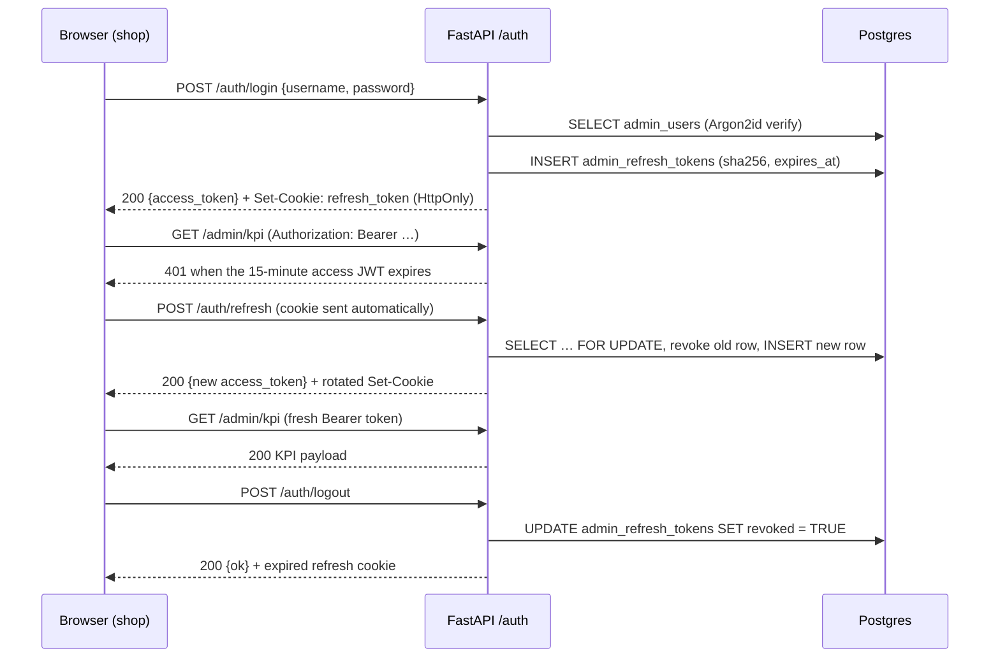
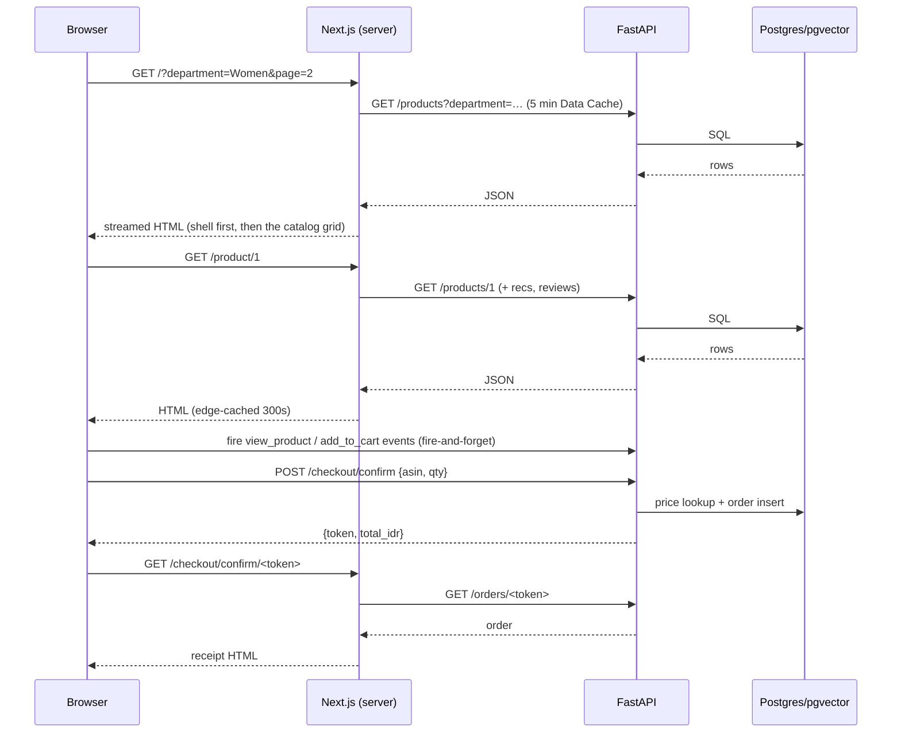

# `shop/` — Toko Marcell storefront (Next.js 16 App Router)

[](https://nextjs.org)
[](https://react.dev)
[](https://tailwindcss.com)
[](https://vitest.dev)
[](https://toko-marcell.vercel.app)

The client-facing storefront. It renders the catalog and product pages on the server, keeps the
search/filter state in the URL, keeps the cart in `localStorage`, and talks to the FastAPI backend
over HTTP. It never touches a database and never decides a price.

🌐 **Live:** [https://toko-marcell.vercel.app](https://toko-marcell.vercel.app)

---

## Why it is built this way

A recruiter opening this link decides in seconds whether it works. That drove four deliberate choices:

1. **Server-render first paint, hydrate interaction.** Home, catalog results and product pages are
   React Server Components; only the parts that need state (search box, filter-link pending state,
   cart, copilot, wakeup) are client components. No JS bundle is needed to see the page.
2. **Cache aggressively, revalidate in the background.** Product detail pages are ISR-cached at the
   edge for 5 minutes and stream their slow sections (reviews, recommendations) behind `Suspense`.
   A cached product page answers in ~5 ms instead of ~1 s.
3. **Never show a broken-looking page.** The backend is on a free tier that sleeps; the UI detects
   that and explains it (see the wakeup overlay).
4. **The client cannot lie about money.** The cart sends `{asin, qty}` only; the server computes the
   order total.

---

## Feature tour

### 1. Server-rendered catalog (`app/page.js` + `CatalogResults`)

- `page.js` reads `searchParams` (`?department=`, `?page=`, `?q=`) and renders `CatalogResults` inside
  a `Suspense` boundary. The grid, result count and pager arrive in the streamed HTML — the shopper
  sees the real 24-card page, not a client fetch.
- `CatalogFilters` (facets from `/categories`) and `CatalogResults` are sibling Suspense boundaries,
  so both fetches start together and a slow facet query never delays the products.
- `CatalogResultsSkeleton` matches the real `grid-cols-2 gap-3 sm:grid-cols-4` grid, so streaming in
  the cards does not reflow the page.
- **Debounced text search** (250 ms) updates the URL with `router.replace`; the input lives outside
  the Suspense boundary, so it never loses focus while the new grid renders. Typed-ahead text is
  protected from an older in-flight query landing late. Ranking still happens server-side
  (BM25 + dense vectors + RRF) via `/search`.
- **Filter pills and pagination are real `<a href>` links** (`scroll={false}`), so they work without
  JavaScript, are prefetchable and can be opened in a new tab. Pending state is a small spinner on
  the link that was clicked (`useLinkStatus`), never a page-wide overlay.
- **Cache contract:** browse reads (`/products`, `/categories`) pass `next: { revalidate: 300 }` and
  are shared by every visitor. Search is `cache: "no-store"` because its URL is unbounded. Server
  reads have a 10 s deadline, so a Render/Neon cold start fails into the retry state instead of
  holding the stream open forever.
- Search-result URLs (`?q=`) are `noindex, follow`; browse pages stay indexable.
- A stale `?page=999` redirects to the last real page, and `q` is clamped to the API's 100-character
  limit before the request.

### 2. Cold-start wakeup overlay (`components/ServerWakeup.js`)

Render's free tier spins the API down after ~15 minutes idle; the next request can take 30–50 s. The
storefront makes this a designed state instead of a failure:

- Debounced (600 ms) `GET /health` on mount — fast servers never see the overlay.
- If slow: a **fullscreen frosted-glass overlay** with a spinner and an honest message
  (*"Membangunkan server… Render free tier cold start (~30–50 dtk)"*).
- On success: a green *"Server siap & aktif!"* badge for 2.5 s, then unmount.
- On failure: **retry** and **dismiss** controls, so the user is never trapped.

`checkHealth()` in `lib/api.js` falls back to `/categories` if `/health` is blocked by a browser
shield, because a false "down" is worse than a heavier probe.

### 3. Floating AI copilot (`components/CopilotChat.js` + `FloatingCopilot.js`)

- A chat panel mounted globally in `layout.js`, loaded with `dynamic(..., { ssr: false })` so it never
  costs first paint. A floating **"Tanya Admin"** button opens it; **Escape** closes it, and controls
  carry `aria-label`s.
- **Text-only & streaming (v2).** The chat streams a single `message` plus a browser `thread_id` to
  `POST /copilot/chat/stream` (SSE `token` + `done` events), showing a pulsing `"Sedang berpikir..."`
  indicator while waiting for the first token and rendering GitHub Flavored Markdown (including tables)
  via `react-markdown` and `remark-gfm`. Conversation history lives server-side in the LangGraph
  checkpointer, not in the request. **There is no image upload** — product lookup uses the paperclip
  text search below.
- **Starter chips only on a new conversation** (`messages.length === 0`), dynamically adapting between
  store-wide prompts, single-product prompts, and multi-product comparison prompts.
- **Paperclip product search & attach (`📎`)** lets shoppers search the catalog inside the chat bar and
  attach up to 3 products (`context.referenced_asins`), replacing the old separate compare tray.
- Replies render **numbered product cards** (`[1]`, `[2]`), each exposing
  **📎 Lampirkan** and **+ Keranjang** actions, plus an **add-to-cart confirmation with a "Batalkan" undo**.
- Agent `add_to_cart` ui_actions are executed through `CartProvider`, so a chat-driven add updates
  `localStorage`, the header count and the cart page — the server never tries to write the cart itself.
- **Attached product chips** show which products the conversation is anchored to, and a **reset button**
  clears the thread (`DELETE /copilot/threads/{id}` + wipes the local copy).

### 3b. Product-page copilot entry (`components/ProductCopilotEntry.js`)

On a product page, a **"Tanya soal produk ini"** button opens the **same floating copilot** that
`app/layout.js` mounts on every page (bottom-right), **pinned to that product**, so follow-ups resolve to
the right ASIN and the product starter chips appear. It renders no chat of its own: it dispatches a
`copilot:open` window event (`{asin, title}`) that the single `CopilotChat` instance listens for.

### 4. Cart without accounts (`components/CartProvider.js`)

- React Context + `localStorage` under the key **`toko-cart-v2`**, persisted across tabs and refresh.
- Supports add / increase / decrease / set-qty (clamped 1–99) / remove / clear, with `subtotal` and a
  derived `cartCount`.
- Each line stores `{id, asin, title, priceIdr, imageUrl, qty}`. The `asin` is required for the server
  to price the cart, which is why the storage key was bumped from v1 — an old v1 line has no asin and
  cannot be priced, and a silent migration would have produced unpriceable lines.
- `add_to_cart` funnel events are emitted for **every** entry point (card, PDP, copilot), so the funnel
  cannot miss a path.

### 5. Product detail with ISR and streaming (`app/product/[id]/page.js`)

- `export const revalidate = 300` **plus** an empty `generateStaticParams()` → the dynamic segment is
  allowed to be generated on demand and cached. Without the params function Next treats the route as
  fully dynamic and the `Cache-Control: private, no-store` header never becomes `s-maxage=300`.
- The three catalog fetches (`getProduct`, `getItemRecs`, `getProductReviews`) pass
  `next: { revalidate: 300 }`; Next 15+ defaults `fetch` to `no-store`, so a route-level `revalidate`
  alone does not make the data cacheable.
- `loading.js` + `ProductPageSkeleton` paint the page shape the moment a product card is clicked;
  the card itself stays inert so the shopper lands on the PDP skeleton rather than a spinner overlay.
- Reviews and the **"Customers also viewed"** rail each sit in their own `Suspense` boundary, so a
  slow reviews query or an empty rail never delays the product details.
- `ProductImage` keeps an `animate-pulse` shimmer (honouring `prefers-reduced-motion`) until the
  image has loaded, and `ProductCard` is one component for both the grid and the Copilot's cards.
- `generateMetadata` produces a per-product `<title>`/description for sharing.
- `TrackView` fires a `view_product` event on mount (deduplicated per ASIN).
- `not-found.js` renders the missing-product page. Because `loading.js` flushes the shell, a missing
  id is a *soft* 404 (HTTP 200 plus `noindex`); real ids keep their 200. Worth knowing before you
  rely on the status code.

### 6. Demo checkout (`app/checkout`, `checkout/qris`, `checkout/confirm/[token]`)

- `/checkout` shows the order summary and fires `checkout_start` once per visit.
- `/checkout/qris` renders a clearly-labelled **QRIS simulation**; "I have paid" calls
  `POST /checkout/confirm`, which creates the authoritative order server-side and returns a secret
  token.
- `/checkout/confirm/[token]` **fetches** the order (it is a server component) and renders it. An
  invalid token renders a 404, never a fake receipt. `ClearCart` empties the local cart on success.
- The client sends only `{asin, qty}`; the server prices it. A tampered total cannot get through.

### 7. Recommendations & reviews

- `RecommendationsRail` on the home page calls `/recs/session` (falls back to global popularity when
  the visit is cold) and exposes a "load more" control.
- `ProductReviews` renders the star breakdown and real review text from `/products/{id}/reviews`.

### 8. Executive KPI dashboard (`app/admin/kpi/page.js`)

The operations surface at **`/admin/kpi`** is a client page that reads `GET /admin/kpi` and renders
the v2 executive dashboard. It is gated end to end: no KPI request is made until an admin session
exists, and a `401`/`403` tears the session down and returns to the login gate.

**What the v2 dashboard shows**

- A **7 / 30 / 90-day** window switcher, a manual **Refresh** control with an `aria-busy` spinner, and
  a **Sign Out** button next to the signed-in username.
- **Overview** — revenue, paid-order count, sessions, average order value, and session → order
  conversion with its "roughly 1 in N" reading.
- **Conversion funnel** — view → add-to-cart → checkout → paid order, with the biggest stage-to-stage
  drop called out. Bars and rates use session counts while revenue uses order counts (one session can
  place more than one order); the UI states that distinction instead of hiding it.
- **Cohort lift & unit economics** — copilot versus non-copilot cohorts, explicitly labelled
  *observational — not a randomized trial*, beside cost per turn / conversation / resolved
  conversation / assisted order.
- **Assistant & demand** — copilot quality (total turns, unanswered and deflection rates, thumbs
  up/down, latency) and search health (searches, zero-result rate, top zero-result queries).
- A permanent **“Demo data”** banner with a `<details>` caveat, because the numbers are derived from
  seeded/simulated data, not audited revenue.
- Published **chart rules**: one quantity per encoding from a zero baseline, labelled scales, rates as
  text rather than bars, colour only for categories, and every bar duplicated by a real number for
  screen readers.

`getAdminKpi()` never caches (`cache: "no-store"`) and prefers the current session's access token, so
an access token rotated by a silent refresh is not replayed.

### 8b. Admin login (`components/AdminLoginModal.js`)

- `TokenGate` renders the modal as a **non-dismissible gate** (`dismissible={false}`) when no access
  token is available; there is no read-only or blurred-data fallback.
- **Demo login** fills and submits `admin` / `marcell-admin-2026`; the manual form validates that both
  fields are non-empty before calling `adminLogin()`.
- Accessibility: `role="dialog"`, `aria-modal="true"`, labelled title and description via `useId`,
  focus moved to the username field on open, **Escape** closes it when dismissible, and the submit
  button is disabled while the request is in flight.
- Errors from the API (`401` → "Invalid username or password") are rendered inline without leaking
  internals. A legacy `?token=` link is stored as a one-shot admin token and stripped from the URL, so
  scripts keep working without leaving the secret in browser history.

### 8c. Dual-JWT + HttpOnly rotating refresh-token lifecycle

The dashboard uses two credentials with different lifetimes and different exposure:

| Credential | Lifetime | Storage | Purpose |
|---|---|---|---|
| **Access JWT** (`HS256`) | 15 minutes (`ACCESS_TOKEN_EXPIRE_MINUTES`) | In-memory + `sessionStorage` (`toko_admin_access_token`) | `Authorization: Bearer …` on `/admin/kpi` |
| **Refresh token** | 7 days (`REFRESH_TOKEN_EXPIRE_DAYS`) | **HttpOnly** cookie `refresh_token`, `Path=/`, `SameSite=Lax`, `Secure` on HTTPS | Redeeming a fresh access JWT |

The refresh token is a 48-byte `secrets.token_urlsafe` value. The database stores **only its SHA-256
digest** in `admin_refresh_tokens.token_hash`, so neither JavaScript nor a database dump can replay it.

Auth calls go through the storefront's own origin: `src/app/api/auth/[...path]/route.js` proxies
`/api/auth/*` to the API at request time. That keeps the refresh cookie **first-party** — a browser
drops a `SameSite=Lax` cookie on a cross-site `*.vercel.app` → `*.onrender.com` request, which ended
every session as soon as the 15-minute access JWT expired. Only `/api/auth/*` is proxied, so chat
streaming and the rest of the API are unaffected.



Lifecycle rules enforced server-side:

1. **Login** verifies Argon2id credentials, inserts a refresh-token hash, and returns a 15-minute
   access JWT. The refresh cookie is set with `HttpOnly`, `SameSite=Lax`, `Path=/`, and `Secure`
   whenever the request arrived over HTTPS.
2. **Every admin request** sends the access JWT as a Bearer token. A `401` triggers exactly one
   silent `POST /auth/refresh` (with `credentials: "include"`); if that fails, the stored session is
   cleared and the login gate returns.
3. **Rotation on every use.** A successful refresh revokes the presented row and inserts a new one
   inside `SELECT … FOR UPDATE`, issuing both a new access JWT and a new cookie. Refresh tokens are
   single-use.
4. **Reuse detection.** Presenting an already-revoked token is treated as theft: every active refresh
   token for that user is revoked, the reason is logged, and `401` is returned — the whole family of
   sessions is shut down, not just the replayed token.
5. **Expiry and logout.** Expired tokens are marked revoked and rejected; logout revokes the presented
   token server-side and clears the cookie. `adminLogout()` clears in-memory and `sessionStorage`
   state in a `finally` block, so signing out still works when the API is unreachable.
6. **Legacy fallback.** `X-Admin-Token` (or `?token=`) and the static `ADMIN_TOKEN` environment
   variable remain accepted for scripts; the dashboard prefers JWT auth whenever it is available.

---

## Tech stack

| Layer | Choice |
|---|---|
| Framework | **Next.js 16** (App Router, RSC, Turbopack) |
| Runtime UI | **React 19** |
| Styling | **Tailwind CSS v4** + `Geist` variable font (`next/font`, `display: swap`) |
| State | React Context + `localStorage` (no state library) |
| Icons | Inline SVG (no icon dependency) |
| Tests | **Vitest 5** + Testing Library + jsdom 30 |
| Hosting | Vercel (edge ISR + security headers) |

---

## Getting started

```bash
cd manual/shop
npm install
```

Create `shop/.env.local`:

```env
NEXT_PUBLIC_API_URL=http://localhost:8001
```

```bash
npm run dev      # http://localhost:3000
npm test         # 108 tests across 20 suites
npm run lint
npm run build
```

The API URL is resolved per environment in `lib/api.js`: on the server it prefers
`INTERNAL_API_URL` (container networking, e.g. `http://api:8000`), on the client it uses
`NEXT_PUBLIC_API_URL`. The built-in fallback is `http://localhost:8001`, so a **production deploy must
set `NEXT_PUBLIC_API_URL`** (and ideally `INTERNAL_API_URL` for server-side fetches) or the browser will
look for a backend on localhost.

---

## Environment variables

| Variable | Used | Default | Purpose |
|---|---|---|---|
| `NEXT_PUBLIC_API_URL` | client + server | `http://localhost:8001` | Public API base URL (**required** in production) |
| `INTERNAL_API_URL` | server only | falls back to `NEXT_PUBLIC_API_URL` | Container-internal API URL (avoids a round trip through the public host) |

The admin auth proxy (`app/api/auth/[...path]`) resolves `INTERNAL_API_URL || NEXT_PUBLIC_API_URL` per
request, so it works behind Vercel and inside `docker compose` (where the API is `http://api:8000`)
without rebuilding the image.

---

## Component & route map

```text
src/
├── app/
│   ├── layout.js                 # header, footer, CartProvider, ServerWakeup, FloatingCopilot
│   ├── page.js                   # home: hero, RecommendationsRail, server-rendered catalog + Suspense
│   ├── globals.css               # Tailwind v4 theme + design tokens
│   ├── product/[id]/page.js      # PDP: ISR + Suspense-streamed reviews and recs
│   ├── product/[id]/loading.js   # instant skeleton while the PDP resolves
│   ├── product/[id]/not-found.js # missing product page
│   ├── admin/kpi/page.js         # executive KPI dashboard v2 + login gate + refresh/sign-out
│   ├── cart/page.js              # cart overview
│   └── checkout/
│       ├── page.js               # order summary (fires checkout_start)
│       ├── qris/page.js          # QRIS simulation → server-confirmed order
│       └── confirm/[token]/page.js   # server-fetched receipt; 404 on bad token
├── components/
│   ├── CatalogSearch.js          # debounced search box, GET-form fallback, pending status
│   ├── CatalogFilters.js         # async facet pills from /categories
│   ├── FilterLink.js             # department pill with per-link pending state
│   ├── CatalogResults.js         # async products/search grid, count, empty/error, pager
│   ├── CatalogPagination.js      # Prev/Next links + scroll-to-catalog
│   ├── CatalogResultsSkeleton.js # results Suspense fallback (matches the real grid)
│   ├── CatalogFiltersSkeleton.js # facet pill-row fallback
│   ├── RetryButton.js            # router.refresh() after a failed catalog read
│   ├── SearchAnalytics.js        # fires the search event once per committed query
│   ├── ProductCard.js            # one card for the grid, rec rails and the copilot
│   ├── ProductCardSkeleton.js    # per-card placeholder
│   ├── ProductPageSkeleton.js    # PDP fallback (hero + details + reviews + recs rail)
│   ├── ProductImage.js           # next/image wrapper with a load shimmer
│   ├── AddToCartButton.js        # PDP quantity + add
│   ├── CartLink.js               # header cart badge/count
│   ├── CartProvider.js           # cart context + localStorage (toko-cart-v2)
│   ├── ClearCart.js              # clears the cart on the success page
│   ├── ProductReviews.js         # rating breakdown + review list
│   ├── RecommendationsRail.js    # session recommendations + load more
│   ├── TrackView.js              # fires view_product once per ASIN
│   ├── ServerWakeup.js           # cold-start health ping + overlay
│   ├── CopilotChat.js            # v2 copilot panel (streaming SSE, react-markdown, paperclip product search/attach, undo)
│   ├── ProductCopilotEntry.js    # "Tanya soal produk ini" button on the PDP; opens the floating copilot pinned to the product (copilot:open event)
│   ├── AdminLoginModal.js        # accessible admin login dialog (demo + manual credentials)
│   └── FloatingCopilot.js        # lazy, client-only mount for the copilot
└── lib/
    ├── api.js                    # the ONLY place that knows the API URL; all fetches
    ├── catalogParams.js          # PAGE_SIZE + parse/build the ?department/?page/?q contract
    ├── formatRp.js               # IDR currency formatting
    └── session.js                # anonymous session id + copilot thread id/messages (local storage)
```

### Data flow



---

## Testing

```bash
npm test
```

**108 tests across 20 suites**:

| Suite | Tests | Covers |
|---|:---:|---|
| `components/__tests__/CartProvider.test.jsx` | 7 | empty cart, add, duplicate merge, quantity, remove-at-zero, clear, multi-item subtotal |
| `components/__tests__/AddToCartButton.test.jsx` | 3 | add with quantity, navigate home, existing-quantity display |
| `components/__tests__/ServerWakeup.test.jsx` | 6 | waking indicator with spinner, ready indicator on healthy check, dual Render/Neon payload from `checkHealth`, 2.5 s polling until the database wakes, error fallback when neither answers, retry from the error state |
| `components/__tests__/CopilotChat.test.jsx` | 21 | no image-upload or TB/BB form, starter chips only when empty, product-page chips, `copilot:open` event attaches product, paperclip search & attach, pulsing `"Sedang berpikir..."` + streaming markdown, `add_to_cart` ui_action, numbered product cards, dedicated outfit card with add-all-to-cart, thumbs feedback, reset deletes thread |
| `components/__tests__/ProductCard.test.jsx` | 3 | grid link and fields, chat variant badge/actions/navigation, missing-id fallback link |
| `components/__tests__/CatalogSearch.test.jsx` | 8 | debounce → one replace, department preserved, no-op for a matching query, external q adoption, typing-race guard, clear, form submit, no-JS hidden department |
| `components/__tests__/CatalogResults.test.jsx` | 6 | browse fetch/grid/count, search endpoint + analytics, both empty states, error + retry, out-of-range redirect |
| `components/__tests__/CatalogPagination.test.jsx` | 4 | next/prev hrefs, disabled bounds, department/query preservation, hidden for zero results |
| `components/__tests__/CatalogFilters.test.jsx` | 2 | pills preserve the query and mark the active one, facet-failure fallback |
| `components/__tests__/CatalogSkeletons.test.jsx` | 2 | 24-card grid + single status, aria-hidden pill row |
| `components/__tests__/SearchAnalytics.test.jsx` | 2 | one event per query, empty query ignored |
| `lib/__tests__/catalogParams.test.js` | 11 | param parsing (arrays, invalid pages, whitespace, 100-char clamp), URL building/encoding, total pages |
| `components/__tests__/ProductImage.test.jsx` | 3 | shimmer until load, placeholder on error, placeholder with no `src` |
| `components/__tests__/ProductPageSkeleton.test.jsx` | 3 | single loading announcement, hero + reviews + rail placeholders, optional sections |
| `app/product/[id]/__tests__/loading.test.jsx` | 1 | the route's `loading.js` renders the skeleton |
| `app/admin/kpi/__tests__/page.test.jsx` | 10 | demo login renders KPIs, manual login, window switch and refresh refetch, sign out, 401 returns to the login gate, tab-restored session, legacy `?token=` consumption |
| `lib/__tests__/session.test.js` | 2 | id persists in `sessionStorage`, stable across calls |
| `lib/__tests__/resumeCopilot.test.js` | 4 | posts only thread + session + yes/no, coerces `approve` to a boolean, carries the HTTP status and server message on failure |
| `lib/__tests__/streamStatus.test.js` | 4 | status labels then tokens then the done payload, unknown event types ignored, no callback and malformed lines tolerated |
| `lib/__tests__/adminRefresh.test.js` | 6 | same-origin refresh so the cookie stays first-party, token persisted, one request for concurrent callers, no stuck in-flight promise, Web Locks across tabs, session cleared on rejection |

CI also runs `npm run lint` and `npm run build` so the Next build cannot regress silently.

---

## Design decisions

- **`lib/api.js` is the single HTTP boundary.** Every fetch, error message and fallback lives there,
  which is why the components stay readable and why the "friendly error, never leak internals" rule
  holds everywhere.
- **URL as state.** Filters/search/pagination live in the query string, not only in React state, so
  views are shareable and navigation works.
- **Fire-and-forget analytics.** `postEvent` swallows errors and uses `keepalive: true`. A dropped
  event is cheaper than a broken purchase.
- **Anonymous identity.** `session.js` generates an id in `sessionStorage` (with a non-secure-context
  fallback for plain-http LAN addresses) — enough to attribute a funnel, not enough to identify a
  person.
- **No UI kit.** Small components with plain Tailwind keep the bundle and the dependency surface small.

---

## Known limitations

- The catalog route is dynamically rendered because it reads `searchParams`. `/products` and
  `/categories` are cached in the Data Cache for 5 minutes, so the database work is amortised, but the
  HTML itself is not a static CDN artifact. PPR/Cache Components is the next step if that matters.
- The QRIS screen is an explicit simulation and charges nothing; it exists to exercise the
  server-authoritative checkout path.
- The copilot's inline product cards depend on the backend's response schema; if a tool returns no
  products the panel simply shows text.
- Cold starts are handled, not eliminated — the live API is on a free tier.

---

### Related docs

- [`../README.md`](../README.md) — project overview
- [`../api/README.md`](../api/README.md) — endpoints, search internals, checkout guarantees
- [`../pipelines/README.md`](../pipelines/README.md) — where the data comes from
